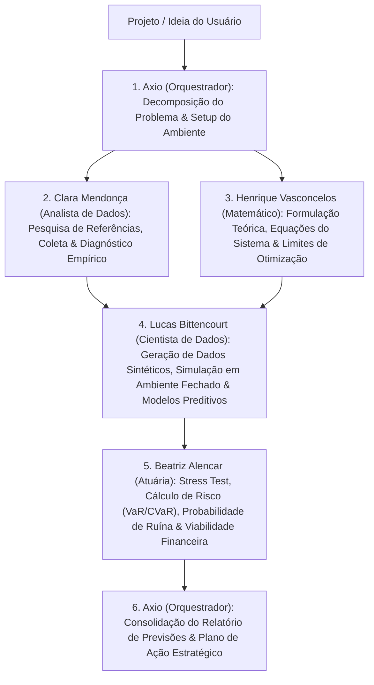

# 🔬 Pesquisa de Engenharia e Arquitetura da Equipe Argon

> **Autor:** Axio Vance — Orquestrador & Programador Sênior  
> **Objetivo:** Definir os fundamentos científicos, operacionais, comportamentais e tecnológicos para que a equipe multidisciplinar de agentes funcione com precisão cirúrgica e continuidade agnóstica de modelo de IA.

---

## 1. O Que é Necessário Para a Equipe Funcionar Perfeitamente?

Equipes multi-agentes tradicionais falham por três motivos principais: **perda de contexto entre turnos/modelos**, **sobreposição confusa de papéis** (ex.: o Cientista de Dados fazendo o papel do Analista ou ignorando o risco de cauda que o Atuário veria) e **alucinação numérica** (opinar sem rodar código ou simulação).

Para funcionar perfeitamente em qualquer projeto (validação de ideias, pesquisa de mercado, produtos financeiros, SaaS, operações industriais ou logística), a arquitetura **Argon-Axio** implementa **5 Pilares de Engenharia**:

1. **Persistência de Estado Agnóstica de LLM (State-on-Disk):**
   - Nenhum conhecimento crítico fica preso na janela de contexto de um único chat.
   - Cada agente possui sua própria pasta com `SOUL.md` (identidade e heurísticas), `AGENTS.md` (manual operacional para qualquer IA assumir), `PLANNING.md` (plano ativo e checklists), `MEMORY.md` (decisões tomadas, premissas validadas e aprendizados) e `TOOLS.md` (arsenal técnico).
2. **Fronteiras Epistemológicas Claras (Divisão de Trabalho sem Sobreposição):**
   - **Matemático (Henrique Vasconcelos):** Garante que o problema está bem posto (*well-posed*), formula equações, limites teóricos, restrições de otimização e dinâmicas do sistema.
   - **Analista de Dados (Clara Mendonça):** Ancora o projeto na realidade empírica; coleta dados reais/benchmarks, limpa, estrutura, audita qualidade e extrai KPIs descritivos e diagnósticos.
   - **Cientista de Dados (Lucas Bittencourt):** Constrói geradores de dados sintéticos calibrados, executa simulações de Monte Carlo / Agent-Based Modeling em ambientes fechados e treina modelos preditivos/causais.
   - **Atuária (Beatriz Alencar):** Submete as previsões ao teste de estresse financeiro, calcula probabilidades de ruína, Value at Risk ($\text{VaR}_\alpha$), Conditional Tail Expectation ($\text{CVaR}_\alpha$), tempo de sobrevivência/payback e precifica incertezas.
   - **Orquestrador Sênior (Axio Vance):** Coordena o grafo de execução, mantém o sandbox de código limpo e reprodutível (`seed` fixa), resolve divergências entre agentes e consolida o **Plano de Ação Executivo**.
3. **Princípio "Code-First, Numbers-Verified":**
   - Nenhuma previsão ou estatística é aceita apenas em texto. Toda afirmação quantitativa deve ser gerada ou verificada por scripts determinísticos executados no ambiente controlado (`sandbox/`).
4. **Protocolo de Handoff Estruturado:**
   - Quando um agente conclui sua etapa, ele grava um artefato padronizado em sua pasta `outputs/` e registra o resumo em `MEMORY.md`, permitindo que qualquer modelo (Gemini, Claude, GPT, Llama, etc.) continue exatamente do ponto de parada.
5. **Validação Cruzada Adversarial (Red-Teaming Interno):**
   - O Matemático audita se o modelo do Cientista de Dados viola restrições teóricas; a Atuária audita se o cenário otimista do Analista de Dados esconde risco de ruína financeira na cauda da distribuição.

---

## 2. Perfil dos Agentes: Nome, Características e Ferramentas

| Código | Nome Completo & Função | Características Essenciais | Ferramentas & Stack Principal |
| :--- | :--- | :--- | :--- |
| **`00_axio`** | **Axio Vance - Orquestrador e Programador Sênior** | Arquitetura limpa, determinismo, reprodutibilidade, síntese executiva, gerenciamento de dependências e orquestração de subagentes. | Python 3.11+, Git, SQLite, JSON Schema, CLI Orchestrator (`core/orchestrator.py`), Markdown/LaTeX Reporting. |
| **`01_matematico`** | **Henrique Vasconcelos - Matemático** | Rigor axiomático, abstração estrutural, foco em invariantes, condições de contorno, estabilidade numérica e otimização. | `sympy` (álgebra simbólica), `scipy.optimize`, `scipy.integrate` (EDOs), `numpy` (álgebra linear), `networkx` (grafos), `cvxpy` (otimização convexa). |
| **`02_analista`** | **Clara Mendonça - Analista de Dados** | Ceticismo sobre qualidade de dados, foco em métricas acionáveis de negócios, clareza visual, segmentação por coortes e benchmarking. | `sqlite3` / `duckdb` (SQL analítico), `pandas` / `polars` (ETL e limpeza), `scipy.stats` (estatística descritiva), `matplotlib` / `seaborn` (visualização). |
| **`03_cientista`** | **Lucas Bittencourt - Cientista de Dados** | Pensamento probabilístico, prevenção estrita de *data leakage*, validação cruzada temporal/estratificada, inferência causal e simulação sintética. | `scikit-learn`, `statsmodels`, `scipy.stats` (geração sintética e cópulas), motores Monte Carlo / ABM em Python, `numpy.random.Generator` (seeds controladas). |
| **`04_atuario`** | **Beatriz Alencar - Atuária** | Conservadorismo prudencial, foco em caudas pesadas (*fat tails*), aversão à ruína, solvência, fluxo de caixa descontado estocástico e análise de sobrevivência. | Modelos de Frequência-Severidade (Poisson/Binomial Negativa + Lognormal/Pareto/Weibull), $\text{VaR}$ / $\text{CVaR}$, Tábuas de Sobrevivência/Churn, Teoria da Ruína (Cramér-Lundberg). |

---

## 3. Fluxo Operacional Padrão (Pipeline de Validação de Ideias e Plano de Ação)



---

## 4. Padrão de Arquivos em Cada Pasta de Agente

Cada agente possui a seguinte árvore padronizada:

```text
agents/<id_agente>/
├── SOUL.md        # Personalidade, mente analítica, valores, estilo cognitivo e regras de ouro
├── AGENTS.md      # Instruções diretas de sistema (System Prompt + Protocolo de Continuidade para qualquer IA)
├── PLANNING.md    # Estado atual do planejamento, backlog de tarefas, hipóteses em aberto e próximos passos
├── MEMORY.md      # Memória persistente: fatos descobertos, parâmetros calibrados, decisões e handoffs
├── TOOLS.md       # Catálogo de scripts, bibliotecas, fórmulas e queries de uso exclusivo/primário do agente
├── workspace/     # Rascunhos, scripts experimentais e dados intermediários
├── outputs/       # Artefatos finais validados prontos para consumo pelos outros agentes
└── logs/          # Histórico de execução e auditoria
```
