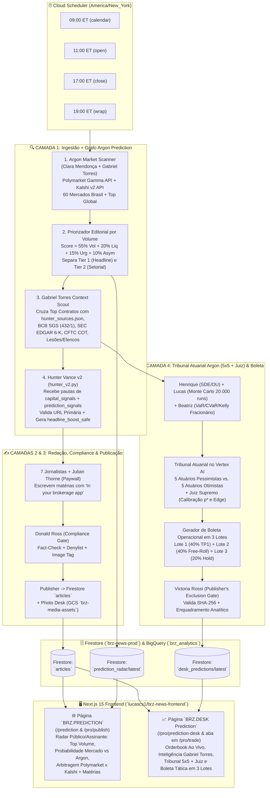

# 🏛️ Arquitetura de Integração Diária: Grafo Argon $\leftrightarrow$ BRZ News (`Hunter Vance`, `BRZ.PREDICTION` e `BRZ.DESK Prediction`)

**Projeto GCP:** `brz-news-prod` (`projects/533645601719` · `us-central1` / `global`)  
**Repositórios Analisados (GitHub do Lucas — `lucascs1` & `awilsonnavis-afk`):**
- **Backend (`lucascs1/brz-news-backend` | [C:\NWX\brz-backend-publish-20261016](file:///C:/NWX/brz-backend-publish-20261016)):** [run_full_pipeline.py](file:///C:/NWX/brz-backend-publish-20261016/scripts/entrypoints/run_full_pipeline.py), [hunter_v2.py](file:///C:/NWX/brz-backend-publish-20261016/src/agents/hunter_vance/hunter_v2.py), [capital_signals.py](file:///C:/NWX/brz-backend-publish-20261016/src/agents/data_engineering/capital_signals.py), [importance.py](file:///C:/NWX/brz-backend-publish-20261016/src/agents/editor/importance.py), [analysis_desk.py](file:///C:/NWX/brz-backend-publish-20261016/src/agents/albert_ryan/analysis_desk.py), [departments.py](file:///C:/NWX/brz-backend-publish-20261016/src/agents/desk/departments.py), [LANES.yml](file:///C:/NWX/brz-backend-publish-20261016/LANES.yml) e [DATA_CONTRACT.md](file:///C:/NWX/brz-backend-publish-20261016/docs/DATA_CONTRACT.md).
- **Frontend (`lucascs1/brz-news-frontend` | [C:\NWX\brznews-daily-news-20261016](file:///C:/NWX/brznews-daily-news-20261016)):** [TradingDesk.tsx](file:///C:/NWX/brznews-daily-news-20261016/src/app/pro/trade/TradingDesk.tsx), [OrderTicket.tsx](file:///C:/NWX/brznews-daily-news-20261016/src/app/pro/trade/OrderTicket.tsx), [PredictionMarkets.tsx](file:///C:/NWX/brznews-daily-news-20261016/src/app/pro/publish/PredictionMarkets.tsx), [prediction-markets.ts](file:///C:/NWX/brznews-daily-news-20261016/src/lib/prediction-markets.ts) e [LANES.yml](file:///C:/NWX/brznews-daily-news-20261016/LANES.yml).
- **Motor Quantitativo & Tribunal Atuarial (`awilsonnavis-afk/nwx-Argon`):** [brz_news_daily_prediction_graph.py](file:///c:/NWX/nwx-Argon/core/brz_news_daily_prediction_graph.py).

---

## 1. Diagnóstico do Ecossistema Atual (GitHub do Lucas & Hunter Vance)

### 1.1. Como funciona o `Hunter Vance v2` hoje ([hunter_v2.py](file:///C:/NWX/brz-backend-publish-20261016/src/agents/hunter_vance/hunter_v2.py))
1. **Posicionamento Editorial (`2026-10-12`):** *"Brazil, decoded for global investors."* O leitor-alvo é o investidor americano com conta em corretora (`Fidelity`, `Schwab`, `Robinhood`, `Alpaca`, `Tradier`, `TradeStation`, `tastytrade`, `moomoo`). A pauta **sempre nasce do dinheiro dele** (um ADR listado em NY como `PBR`, `VALE`, `NU`, `ITUB`, `BBD`, `ERJ`, o ETF `EWZ`, o diferencial de juros `Fed vs Copom`, ou commodities que ele consome).
2. **Fontes & Anti-SSRF ([config/hunter_sources.json](file:///C:/NWX/brz-backend-publish-20261016/config/hunter_sources.json)):**
   - Coleta feeds RSS de 7 editorias (`Markets`, `Investing`, `Tech`, `Politics`, `Small Caps`, `Currencies`, `Agro`) com validação estrita de domínio (`validate_url`), `input_guardrail` contra prompt injection e desduplicação semântica (`story_dedup.py` intra-rodada e `drop_recent_dupes` contra os últimos 3 dias do Firestore `articles`).
   - Quando bate em paywall (`valor.globo.com`, `oglobo.globo.com`, `estadao.com.br`, `folha.uol.com.br`), marca `needs_investigation: true` e roteia automaticamente para o **Julian Thorne (Investigador)**, que reconstrói o fato a partir de fontes abertas.
3. **Sinal de Capital (`capital_signal`) e Placar de Importância ([importance.py](file:///C:/NWX/brz-backend-publish-20261016/src/agents/editor/importance.py)):**
   - Para uma matéria ganhar **+15 pontos** no `news_score` e furar a fila como `Hero`, a pauta precisa preencher os **6 campos obrigatórios** de `capital_signal` (`instrument_us`, `mechanism`, `number`, `comparator_us`, `source_primary_url`, `as_of`), onde `source_primary_url` **exige** domínio de fonte primária (`bcb.gov.br`, `sec.gov`, `ishares.com`, `federalreserve.gov`, `stlouisfed.org`, `cftc.gov`, `usda.gov`, `b3.com.br`).
   - Além disso, o Hunter gera `headline_boost_safe` (manchete gêmea **sem termos eleitorais** como `election`, `runoff`, `Lula`, `Tarcísio`, `TSE`) para que a Camada 5 Comercial possa impulsionar na Meta Ads sem bloqueio.
4. **Cadência Diária das 4 Janelas ([focus.py](file:///C:/NWX/brz-backend-publish-20261016/src/agents/shared/focus.py) & [deploy_job.sh](file:///C:/NWX/brz-backend-publish-20261016/src/agents/daily_pipeline/deploy_job.sh)):**
   - O Cloud Scheduler dispara o Cloud Run Job `daily-pipeline` em **4 janelas diárias (fuso `America/New_York`)**:
     - **`09:00 ET` (`calendar`):** Agenda econômica BR+EUA, macro e política noturna $\rightarrow$ Carrossel educacional.
     - **`11:00 ET` (`open`):** Abertura de mercado NY/B3 (`Markets`, `Investing`, `NASDAQ`) $\rightarrow$ Post de notícia.
     - **`17:00 ET` (`close`):** Fechamento do pregão $\rightarrow$ `TOP × BOTTOM` do dia (`movers`).
     - **`19:00 ET` (`wrap`):** Resumo do dia e consolidação $\rightarrow$ `BREAKING` da matéria mais relevante + Relatório do CEO Navis.

### 1.2. O Gap Atual de Prediction Markets no Frontend ([prediction-markets.ts](file:///C:/NWX/brznews-daily-news-20261016/src/lib/prediction-markets.ts))
- Hoje, o arquivo [src/lib/prediction-markets.ts](file:///C:/NWX/brznews-daily-news-20261016/src/lib/prediction-markets.ts) no frontend do Lucas lê **apenas 1 evento fixo (hardcoded)**: `brazil-presidential-election` no Polymarket e `KXBRPRES-26` no Kalshi, exibido dentro de `/pro/publish` ([PredictionMarkets.tsx](file:///C:/NWX/brznews-daily-news-20261016/src/app/pro/publish/PredictionMarkets.tsx)).
- Já a mesa de operações [TradingDesk.tsx](file:///C:/NWX/brznews-daily-news-20261016/src/app/pro/trade/TradingDesk.tsx) (`/pro/trade`) possui o gráfico TradingView, a boleta [OrderTicket.tsx](file:///C:/NWX/brznews-daily-news-20261016/src/app/pro/trade/OrderTicket.tsx) (conectada via OAuth a `Alpaca`, `Tradier`, `TradeStation`, `tastytrade`, `moomoo` e `Paper Trading`), o chat do Albert e os cards `MORE_BRZ` (`BRZ.PUBLISH` e `BRZ.AGRO`), mas **ainda não possui a inteligência diária dos 60 mercados preditivos do Brasil nem a Boleta de Contratos / Tribunal Atuarial 5x5**.

---

## 2. Arquitetura do Grafo Diário Argon dentro do BRZ News (`brz-news-prod`)

---

## 3. Como o `Hunter Vance` e o `Gabriel Torres (05)` Operam Juntos Diariamente

Em vez de o Hunter olhar apenas RSS passivos, o **Grafo Argon** atua como um **gerador de gatilhos quantitativos de pauta** (exatamente ao lado de [capital_signals.py](file:///C:/NWX/brz-backend-publish-20261016/src/agents/data_engineering/capital_signals.py) na linha 724 do [hunter_v2.py](file:///C:/NWX/brz-backend-publish-20261016/src/agents/hunter_vance/hunter_v2.py)):

1. **Passo 1 — Detecção de Volume e Anomalia (`08:45 ET`, `10:45 ET`, `16:45 ET`, `18:45 ET`):**
   - O scanner da **Clara Mendonça + Gabriel Torres** varre os 60 contratos brasileiros no Polymarket e as 97 séries no Kalshi.
   - Calcula o **Score Editorial BRZ News** e detecta:
     - **Choque de Probabilidade ($\Delta p \ge 5\%$ em 24h)**
     - **Spread de Arbitragem Cross-Exchange ($\text{Polymarket} - \text{Kalshi} \ge 2.5\%$)**
     - **Concentração de Volume Tier 1 ($\text{Volume} > \text{US\$ } 50\text{k}$)**
2. **Passo 2 — Empacotamento no Contrato do `Hunter Vance` (`prediction_signals.py`):**
   - Cada anomalia vira uma pauta estruturada com:
     - `capital_signal` completo com os **6 campos exigidos** pelo [hunter_v2.py](file:///C:/NWX/brz-backend-publish-20261016/src/agents/hunter_vance/hunter_v2.py#L579-L588) e URL primária verificada (`bcb.gov.br`, `sec.gov`, `cftc.gov`, `ishares.com`), garantindo **+15 pontos** no placar [importance.py](file:///C:/NWX/brz-backend-publish-20261016/src/agents/editor/importance.py#L159).
     - `assets`: sempre encabeçados pelo ticker americano negociável na corretora do leitor (`EWZ`, `PBR`, `VALE`, `ITUB`, `BBD`, `NU`, `MELI`, `ERJ`).
     - `headline_boost_safe`: manchete limpa de termos eleitorais (`_TERMOS_ELEITORAIS`), pronta para impulsionamento pago na Meta Ads.
3. **Passo 3 — Investigação de Contexto pelo `Gabriel Torres` para o Tribunal 5x5:**
   - Para cada contrato que entra na **Mesa de Operações (`BRZ.DESK Prediction`)**, o agente **Gabriel Torres (`05`)** extrai os dois vetores empíricos obrigatórios:
     - **`favorable_drivers` (*"O que favorece essa predição hoje?"*):** Dados primários do BCB (`SGS 432` Selic, `SGS 1` PTAX), SEC EDGAR `6-K`, boletins meteorológicos `SOY_REGIONS` / CFTC COT, ou relatórios oficiais de lesões/elencos (`weekly_rosters_2026.csv`, `EPA/CPOE` no caso de esportes/eventos).
     - **`threat_drivers` (*"O que ameaça ou pode invalidar essa predição?"*):** Volatilidade cambial acima de $2\sigma$, risco de ruína no orderbook, baixas médicas (`IR`/`INA`) ou decisões judiciais/fiscais.

---

## 4. Especificação das Duas Páginas e Seus Contratos de Dados (Firestore $\leftrightarrow$ Next.js)

### 4.1. Página 1: `BRZ.PREDICTION` (Público / Topo e Meio de Funil)
- **Objetivo do Produto:** Ser o ** Termômetro Global de Probabilidades sobre o Brasil** em inglês para o investidor americano. Substitui a leitura estática de 1 único mercado em [PredictionMarkets.tsx](file:///C:/NWX/brznews-daily-news-20261016/src/app/pro/publish/PredictionMarkets.tsx) por um **Radar Completo de 60 Mercados** ranqueados por volume (`US$ 2.68M+`).
- **Rota no Frontend (`lucascs1/brz-news-frontend`):**
  - Rota dedicada `/prediction` (ou `/pro/publish#predictions` expandida) + item na barra de produtos (`BRZ.PREDICTION`).
  - **Lane no Frontend ([LANES.yml](file:///C:/NWX/brznews-daily-news-20261016/LANES.yml)):** `portal` (ou `pro-terminal`).
- **Fonte de Dados no Firestore:** Documento **`prediction_radar/latest`** (gerado por [core/brz_news_daily_prediction_graph.py](file:///c:/NWX/nwx-Argon/core/brz_news_daily_prediction_graph.py) e salvo em [firestore_brz_prediction_public.json](file:///c:/NWX/nwx-Argon/sandbox/runs/brz_news_daily_integration/firestore_brz_prediction_public.json)).
- **Seções Visuais da Página `BRZ.PREDICTION`:**
  1. **KPIs Globais no Topo:** Volume Total Rastreado (`US$ 2,683,421`), Contratos Ativos (`60`), Volume Polymarket (`US$ 2.08M`) vs. Kalshi (`US$ 595K`).
  2. **Radar de Arbitragem Cross-Exchange (`Polymarket vs. Kalshi`):** Compara lado a lado quanto o mesmo evento (ex.: *Presidência 2026* ou *Corte da Selic no Copom*) está custando no mercado cripto global vs. mercado regulado pela CFTC nos EUA, mostrando o *spread* em pontos percentuais e quais ADRs (`EWZ`, `PBR`, `ITUB`, `NU`) são impactados.
  3. **Grid Tier 1 & Tier 2 (Ordenado por Volume):** Cards com barra dupla (`Probabilidade Implícita do Mercado` vs. `Probabilidade Calibrada Argon`), `Yes Bid / Ask`, `Volume 24h`, tags dos ativos americanos expostos (`EWZ`, `PBR`, `VALE`) e link direto para a matéria editorial escrita pelos jornalistas do BRZ News.

---

### 4.2. Página 2: `BRZ.DESK Prediction` (Terminal Institucional / Assinante PRO)
- **Objetivo do Produto:** Entregar ao assinante do **BRZ.PRO / BRZ.DESK** a mesa quantitativa completa de contratos preditivos e eventos — com **Inteligência de Fontes (Gabriel Torres)**, **Tribunal Atuarial 5x5 + Juiz Supremo** e a **Boleta Tática de Execução em 3 Lotes (*Free-Roll Engine*)** validada com dinheiro real.
- **Rota no Frontend (`lucascs1/brz-news-frontend`):**
  - Nova aba **`Prediction Desk`** dentro de [TradingDesk.tsx](file:///C:/NWX/brznews-daily-news-20261016/src/app/pro/trade/TradingDesk.tsx) (`/pro/trade`) e rota dedicada `/pro/prediction-desk` no menu lateral ([docs/PRO_ESTRUTURA.md](file:///C:/NWX/brz-backend-publish-20261016/docs/PRO_ESTRUTURA.md)).
  - **Lane no Frontend ([LANES.yml](file:///C:/NWX/brznews-daily-news-20261016/LANES.yml)):** `pro-terminal`.
- **Fonte de Dados no Firestore:** Documento **`desk_predictions/latest`** (gerado por [core/brz_news_daily_prediction_graph.py](file:///c:/NWX/nwx-Argon/core/brz_news_daily_prediction_graph.py) e salvo em [firestore_brz_desk_prediction_pro.json](file:///c:/NWX/nwx-Argon/sandbox/runs/brz_news_daily_integration/firestore_brz_desk_prediction_pro.json)).
- **Módulos da Página `BRZ.DESK Prediction`:**
  1. **Painel de Microestrutura & Orderbook (`Bid / Ask / Spread / Liquidez`):**
     - Exibe o preço de entrada (`Entry Yes ¢`), `Best Bid`, `Best Ask`, `Spread` em centavos e liquidez disponível no livro de ofertas.
  2. **Dossiê de Inteligência de Contexto (`Gabriel Torres + Hunter Vance`):**
     - Coluna verde (**Fatores Favoráveis / Catalisadores**) vs. Coluna âmbar (**Ameaças / Riscos de Cauda**), alimentadas em tempo real pelas fontes primárias (`BCB`, `SEC`, `CFTC`, `NFLverse`).
  3. **Placar do Tribunal Atuarial (`5 Pessimistas vs. 5 Otimistas + Juiz Supremo`):**
     - Mostra a probabilidade média da Bancada Pessimista (focada em $\text{CVaR}_{95}$ e risco de ruína), a média da Bancada Otimista (focada em momentum e assimetria) e o **Veredito Calibrado do Juiz Supremo ($p^*$)** com o **Edge em bps** sobre o preço da exchange.
  4. **Boleta Tática de Contratos em 3 Lotes (`Tranche Execution Sheet`):**
     - Calcula automaticamente para qualquer capital de referência (ex.: `US$ 100` ou `US$ 1.000`):
       - **Lote 1 (40% — Take-Profit Inicial):** Preço-alvo, probabilidade matemática de tocar na barreira antes do encerramento ($P(\text{touch})$) e caixa recuperado.
       - **Lote 2 (40% — Trava de *Free-Roll*):** Preço-alvo exato onde a venda de `Lote 1 + Lote 2` recupera **$>100\%$ do capital investido inicialmente** + lucro líquido travado no caixa.
       - **Lote 3 (20% — *Hold* Assimétrico até Liquidação `100¢`):** Lote que corre com **risco zero de principal** (*Free-Roll*) até o final do evento.
       - **Stop-Loss Atuarial:** Barreira inferior de invalidação de tese.
  5. **Track Record Auditado ao Vivo (`Verified Live Case Study`):**
     - Card fixo de prova social e transparência exibindo a operação real executada na Kalshi (`KC Chiefs vs DEN Broncos`, `KXNFLGAME-26NOV01KCDEN-KC`): entrada a `53.75¢` (`130.23 shares`), saída parcial de `104 shares` (`80%`) no Q3 a `77¢` embolsando **`US$ 77.29` em caixa** (100% do principal de `US$ 70.00` + `US$ 7.29` de lucro garantido) e mantendo **`26.23 shares` (`20%`)** em *Free-Roll* (`ROI +43.6%`).

---

## 5. Plano de Implantação Respeitando a Regra `1 PR = 1 Lane` (`LANES.yml`)

O repositório do Lucas utiliza o portão automático `pr_master.py` ([LANES.yml](file:///C:/NWX/brz-backend-publish-20261016/LANES.yml)), que exige **1 PR por Lane**. Por isso, a subida para produção no `brz-news-prod` é dividida em **3 PRs limpos e independentes**:

| Ordem | Repositório | Lane (`LANES.yml`) | Arquivos Adicionados / Modificados | Objetivo do PR |
| :---: | :--- | :--- | :--- | :--- |
| **PR #1** | `brz-news-backend` | `dados-mercado` + `compartilhado` | `src/agents/data_engineering/prediction_markets_argon.py` `scripts/entrypoints/run_full_pipeline.py` | Conecta o scanner Polymarket/Kalshi + motor de probabilidades Argon na Camada 1 do `run_full_pipeline.py` (4x ao dia), gravando `prediction_radar/latest` e `desk_predictions/latest` no Firestore. |
| **PR #2** | `brz-news-backend` | `ingest` | `src/agents/hunter_vance/hunter_v2.py` `src/agents/data_engineering/capital_signals.py` | Conecta os gatilhos de anomalias e arbitragem do Grafo Argon como `pautas_do_dia()` no `Hunter Vance`, gerando pautas automáticas com `capital_signal` (6 campos) e `headline_boost_safe` para os 7 jornalistas. |
| **PR #3** | `brz-news-frontend` | `pro-terminal` | `src/app/pro/prediction-desk/page.tsx` `src/app/pro/trade/PredictionDeskPanel.tsx` `src/app/pro/publish/PredictionMarkets.tsx` | Cria as interfaces `BRZ.PREDICTION` (radar de 60 mercados + arbitragem) e `BRZ.DESK Prediction` (Orderbook + Tribunal 5x5 + Boleta em 3 Lotes com calculadora de *Free-Roll*). |

---

## 6. Artefatos Gerados e Prontos no Repositório `nwx-Argon`

1. **Motor de Integração Diária:** [core/brz_news_daily_prediction_graph.py](file:///c:/NWX/nwx-Argon/core/brz_news_daily_prediction_graph.py)
2. **Pautas Geradas no Contrato do Hunter Vance:** [hunter_prediction_pautas.json](file:///c:/NWX/nwx-Argon/sandbox/runs/brz_news_daily_integration/hunter_prediction_pautas.json)
3. **Documento Firestore para `BRZ.PREDICTION` (`prediction_radar/latest`):** [firestore_brz_prediction_public.json](file:///c:/NWX/nwx-Argon/sandbox/runs/brz_news_daily_integration/firestore_brz_prediction_public.json)
4. **Documento Firestore para `BRZ.DESK Prediction` (`desk_predictions/latest`):** [firestore_brz_desk_prediction_pro.json](file:///c:/NWX/nwx-Argon/sandbox/runs/brz_news_daily_integration/firestore_brz_desk_prediction_pro.json)
