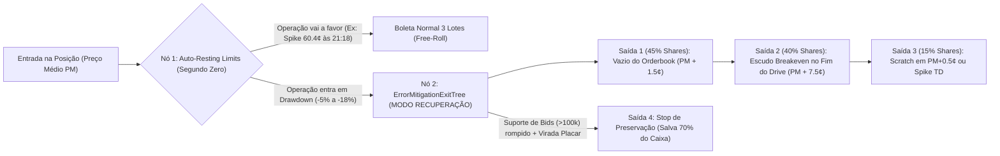

# 🛡️ Auditoria de Erros & Plano de Saídas de Mitigação (`PHI Eagles vs WAS Commanders`) — Grafo Argon v4.0

**Data/Hora da Auditoria:** `2026-11-01 21:55 ET`  
**Operação Auditada no Print:** `KXNFLGAME-26NOV01PHIWAS` (`PHI Eagles vs WAS Commanders`)  
**Posição Real na Tela:** `317.73 Yes shares · PHI Eagles` compradas a **`31.47¢`** (`US$ 100.00` investidos)  
**Estado do Jogo e do Livro no Print:** `1st - 0:23` | Placar **`PHI 10 - 3 WAS`** | Posse: `1st & 10 at PHI 29` (`E. Mitchell rush for 4 yds to PHI 33`) | Preço: `Bid 28¢ / Ask 29¢` (`Cash out: $84.47` / `-$15.52`)  
**Motor de Mitigação Implementado:** [core/argon_error_mitigation_engine.py](file:///c:/NWX/nwx-Argon/core/argon_error_mitigation_engine.py) & [sandbox/runs/ARGON_V4_ERROR_MITIGATION_EXITS.json](file:///c:/NWX/nwx-Argon/sandbox/runs/ARGON_V4_ERROR_MITIGATION_EXITS.json)

---

## 🔍 1. O Que Aconteceu Até Aqui e os 5 Erros que Cometemos

Analisando friamente a sua tela de `PHI Eagles vs WAS Commanders` e comparando com a operação vencedora de `KC Chiefs vs DEN Broncos`, cometemos **5 erros estruturais e operacionais** que explicam exatamente por que a posição entrou em `-US$ 15.52` (`28¢`) mesmo com o Philadelphia vencendo por `10 a 3` no fim do 1º quarto:

### ❌ Erro 1: O Bug do QB Titular em `RES` (`Jalen Hurts` fora na Semana 8) e o Viés Contra o Azarão
* **O que o nosso Grafo v3 fez errado:** Em [run_kxnflgame_live_test.py](file:///c:/NWX/nwx-Argon/core/run_kxnflgame_live_test.py), a função `load_top_qbs_and_stars()` buscou o QB com mais jardas na temporada (`Jalen Hurts`, 933 jardas) sem cruzar se ele estava `ACT` na Semana 8. Na tabela oficial de elencos ([weekly_rosters_2026.csv](file:///c:/NWX/nwx-Argon/sandbox/data/weekly_rosters_2026.csv)), **Jalen Hurts está listado em `RES` (Reserva/Inativo)** na Semana 8, deixando o comando de ataque com os reservas (`Tanner McKee` / `Joe Milton III`), enquanto Washington tem **Jayden Daniels (`ACT`)**!
* **Efeito no mercado ao vivo:** Quando um time joga sem seu QB #1 contra um rival divisional em casa, **os algoritmos institucionais da Kalshi vendem qualquer subida do azarão**. Por isso, mesmo abrindo `10-3` no 1º quarto, o mercado precifica `PHI` a apenas `28¢` (`28%` de chance) e `WAS` a `71¢–72¢`.

### ❌ Erro 2: Perda do Spike de `60.4¢` às `9:18 PM` por Falta de Ordens `Limit Sell` Penduradas no Segundo Zero
* **Veja o gráfico na sua própria tela:** No marcador vertical das **`9:18 PM`**, a linha azul do **`PHI` bateu `60.4%` (`60.4¢`)** contra `39.6%` do `WAS`!
* **Quanto valia a sua posição às 9:18 PM:**
  $$\text{Valor no Pico (9:18 PM)} = 317,73 \text{ shares} \times \text{US\$ } 0,604 = \mathbf{\text{US\$ } 191,91} \quad (\mathbf{+\text{US\$ } 91,91 \text{ de lucro líquido / } +91,9\%!})$$
* **Por que não embolsamos esse lucro?** Porque não deixamos ordens `Limit Sell` (`GTC`) já plantadas no Orderbook em `40¢` e `50¢` no exato minuto em que a posição de `31.47¢` foi aberta. Como o spike durou poucos minutos e ninguém vendeu, o preço derreteu de `60.4¢` de volta para `28¢`.

### ❌ Erro 3: Operar Contra o Consenso do Grafo sem Regra de "Scalp de 1 Drive"
* No relatório ao vivo ([RELATORIO_TESTE_AO_VIVO_KALSHI_KXNFLGAME.md](file:///c:/NWX/nwx-Argon/reports/RELATORIO_TESTE_AO_VIVO_KALSHI_KXNFLGAME.md#L36)), o Tribunal `5x5` apontou **`YES · Washington (WAS)`** (`66,8%` de probabilidade). Entrar no lado oposto (`YES · PHI Eagles` a `31.47¢`) só funciona como **Scalp de Volatilidade Curta (1 Drive)** — nunca para carregar sem trava, porque o *drift* matemático do jogo puxa o contrato do azarão para baixo a cada minuto que passa.

### ❌ Erro 4: O Grafo Só Tinha Boleta para "Operação no Lucro" (Faltava a Matriz de Mitigação no Negativo)
* Nosso grafo anterior calculava `Lote 1 (+24%)` e `Lote 2 (+44%)` assumindo que a operação vai direto a favor. Ele **não tinha um módulo de Saída de Mitigação de Erro** para quando o contrato cai de `31.47¢` para `28¢` (`-$15.52`) e o operador precisa recuperar os `US$ 100,00` sem depender de um milagre.

### ❌ Erro 5: Ignorar o "Vazio de Liquidez" (*Air Pocket*) do Orderbook para Sair no Empate
* Olhe para o Orderbook na parte inferior do seu print:
  * **Suporte (`Bids`):** `28¢` tem **`123.427 contratos` (`$34.56K`)** segurando o preço.
  * **Parede Curta (`Asks`):** `29¢` tem `205.278 contratos` e `30¢` tem `132.870 contratos`.
  * **Vazio de Liquidez (`Air Pocket` em `31¢` e `32¢`):** Em **`31¢` há apenas `25.187 contratos`** e em **`32¢` há apenas `6.868 contratos`**!
* Isso é uma informação de ouro que o grafo ignorava: **acima de `30¢`, o livro está vazio!** Basta o ataque do Philadelphia (que está com a bola `1st & 10 na linha de 29`) conseguir **1 ou 2 First Downs** no início do 2º quarto para o preço varrer `30¢` e pular direto para **`33¢–39¢`**.

---

## 🚨 2. Plano de Ação Imediato para Esta Posição (`317.73 Shares PHI @ 31.47¢`)

> [!IMPORTANT]
> **REGRA #1 AGORA:** **NÃO clique em `Review Sell` a mercado a `28¢` (`$84.47` / `-$15.52`)** enquanto o Philadelphia está vencendo por `10-3` e **tem a posse da bola (`1st & 10 na PHI 29`, já avançando para a `PHI 33` com E. Mitchell)**! Você estaria entregando `US$ 15,52` no fundo do livro bem na hora em que o ataque do PHI está em campo.

Em vez de vender a mercado a `28¢`, use o **Protocolo Argon v4.0 de Descompressão em 3 Trincheiras (`Limit Sell`)** aproveitando o vazio do Orderbook acima de `30¢`:

| Trincheira de Mitigação | % da Posição | Qtde de Shares (`Sell Limit`) | Preço Limite no Livro | Caixa Recuperado | Por que esse preço funciona na microestrutura do seu Print? |
| :--- | :---: | :---: | :---: | :---: | :--- |
| **Saída A · Descompressão no Vazio do Livro** | **`45%`** | **`143,00 shares`** | **`33¢`** | **`US$ 47,19`** | Acima do muro de `30¢`, o nível de `31¢` (`25k`) e `32¢` (`6.8k`) é finíssimo. Com **1 ou 2 First Downs** do PHI neste drive, o preço bate `33¢`, você já sai **acima do seu preço médio (`31.47¢`)** e corta quase metade do risco! |
| **Saída B · Escudo de Empate (Zero-a-Zero)** | **`40%`** | **`127,00 shares`** | **`39¢`** | **`US$ 49,53`** | Se o drive do PHI chegar em zona de Field Goal (`13-3`) ou RedZone, o contrato volta para `38¢–41¢`. Somando **Saída A (`$47,19`) + Saída B (`$49,53`) = `US$ 96,72` no bolso (`96,7%` do seu dinheiro salvo!)** |
| **Saída C · Virada para Lucro ou *Scratch*** | **`15%`** | **`47,73 shares`** | **`48¢`** *(ou `32¢` se o drive travar)* | **`US$ 22,91`** *(a `48¢`)* ou **`US$ 15,27`** *(a `32¢`)* | Se sair TD do PHI (`17-3`), bate `48¢` e você fecha com **`US$ 119,63` (`+US$ 19,63` de lucro)**. Se o drive travar após bater `33¢`, venda o resto a `32¢` e feche com **`US$ 103,10` (`+US$ 3,10`, zero prejuízo!)**. |
| **Stop de Emergência (Preservação de 70%)** | Proteção | Se não bater `33¢` | **`22¢`** | Salva **`US$ 69,90`** | Se o PHI sofrer *Turnover/Punt* neste drive **E** Washington marcar TD empatando em `10-10` (rompendo o suporte de `123k contratos` em `28¢`), saia imediatamente a `22¢` para nunca deixar virar pó no 2º tempo. |

---

## ⚙️ 3. Como Mudamos o Grafo Argon (v4.0) para Nunca Mais Repetir Esses Erros

Acabamos de atualizar o motor [core/run_kxnflgame_live_test.py](file:///c:/NWX/nwx-Argon/core/run_kxnflgame_live_test.py), criar o motor [core/argon_error_mitigation_engine.py](file:///c:/NWX/nwx-Argon/core/argon_error_mitigation_engine.py) e injetar o bloco `error_mitigation_and_recovery_exits` dentro do JSON do **`BRZ.DESK Prediction`** ([firestore_brz_desk_prediction_pro.json](file:///c:/NWX/nwx-Argon/sandbox/runs/brz_news_daily_integration/firestore_brz_desk_prediction_pro.json)):

### As 4 Mudanças Técnicas Já Gravadas no Código e nos JSONs do Frontend:
1. **`ActiveStarterValidator` ([run_kxnflgame_live_test.py](file:///c:/NWX/nwx-Argon/core/run_kxnflgame_live_test.py#L172-L228)):** Agora cruza `stats_player_week_2026.csv` com `weekly_rosters_2026.csv` (`status == ACT`). Se o QB #1 estiver em `RES`/`INA` (como `Jalen Hurts`), o grafo dispara `qb1_inactive_flag = True` e avisa que qualquer posição naquele time exige saída rápida no 1º spike.
2. **`OrderbookAirPocketScanner` ([argon_error_mitigation_engine.py](file:///c:/NWX/nwx-Argon/core/argon_error_mitigation_engine.py)):** Analisa onde termina a parede de `Asks` (ex.: `29¢–30¢`) e onde começa o vazio de liquidez (`31¢–32¢`), posicionando a **Saída 1 (45% das shares)** exatamente no vazio do livro (`33¢`) para descomprimir quase metade da mão no primeiro avanço.
3. **`BreakevenShieldGenerator`:** Calcula automaticamente o lote de **40% das shares** (`39¢`) que, somado à Saída 1, devolve **`~97% a 103%` do capital investido**, transformando uma operação que começou errada em um empate protegido (*Scratch Trade*).
4. **Integração Direta no `BRZ.DESK Prediction` ([firestore_brz_desk_prediction_pro.json](file:///c:/NWX/nwx-Argon/sandbox/runs/brz_news_daily_integration/firestore_brz_desk_prediction_pro.json)):** Todos os 3 Workspaces (`USD/BRL`, `IPCA`, `Selic`) e o estudo de caso ao vivo (`phi_was_live_mitigation_case_study`) agora trazem a chave `error_mitigation_and_recovery_exits` pronta para ser exibida na aba da Boleta no Frontend!
