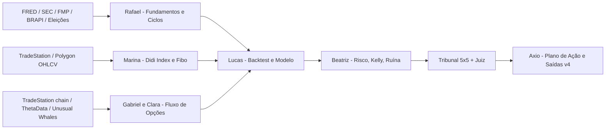

# Mapa de Fontes de Dados — NWX-Argon (Sazonalidade/Eleições + Fundamentos + Didi Index + Opções)

> **Pergunta Nº 1:** *"Quais fontes preciso para gerar esses dados?"*
> Regra: todo número precisa de `fonte`, `endpoint` e `data_coleta`. Sem fonte, não entra no grafo.

---

## 0. ⚠️ Auditoria honesta do que já produzimos

| Dado usado nos relatórios anteriores | Origem real | Status |
|---|---|---|
| Preço, SMA, RSI, ATR, RV 20d (SOFI, NVDA, SPY...) | Yahoo Finance chart API (baixado ao vivo) | ✅ Real |
| Notícias (manchetes SOFI/NVDA) | Yahoo Finance RSS (ao vivo) | ✅ Real |
| **UOA (Vol/OI 5.20x etc.), Skew 25Δ, IV 30d, "whale prints", GEX** | **Digitados à mão em `core/nwx_argon_unified_options_intelligence.py` (linhas ~182–287)** | ❌ **Não são dados de mercado** |
| Fundamentos (short interest 16.8%, FCF, receita) | Digitados no mesmo script, não vieram da FMP | ❌ Não verificados |
| Probabilidade 55% e EV +US$180 (SOFI) | Fórmula com pesos arbitrários sobre os dados acima | ❌ Não confiável |
| Spreads HY ~300 bps / falências +18% | Afirmado no texto, sem download | ❌ Não verificado |
| Monte Carlo (US$ 61k mediana) | Probabilidades de ganho **assumidas** no código, não estimadas | ⚠️ Ilustrativo apenas |

**Consequência:** o raio-x de volume de opções e a recomendação SOFI **não devem ser usados para operar** até as fontes da seção 3 estarem conectadas. A API de opções do Yahoo retornou `401 Unauthorized` hoje — não temos feed de opções ativo.

---

## 1. O vídeo de referência

- **Título:** *"ESTÃO PRONTOS PARA O RALLY DE NATAL? | Estudo de sazonalidade do mercado americano"*
- **Canal:** Igor Mundstock (economista) — publicado 01/11/2026, duração 25:26.
- **Descrição oficial:** apenas links (IBKR, membros/planilhas HeatMap, curso Macro Fundamentos) + aviso de que o conteúdo é educacional.
- **Limitação:** não consegui acessar a transcrição/legenda (YouTube bloqueia download automático) e não assisto vídeo. Portanto **não posso afirmar qual padrão eleitoral exato ele apresenta**. Pelo título e pelo momento (novembro de **ano de midterm**, 2026), o estudo trata de sazonalidade de fim de ano do S&P 500 e sua relação com o ciclo eleitoral americano.
- **Para fechar esta lacuna:** cole aqui a transcrição (YouTube → "…" → *Mostrar transcrição*) ou os 3–5 números-chave do vídeo; a equipe confronta com o nosso estudo abaixo.

### 1.1 Reprodução independente com dados reais
Script: [`seasonality_election_cycle_study.py`](file:///c:/NWX/nwx-Argon/core/seasonality_election_cycle_study.py) → `sandbox/runs/SEASONALITY_ELECTION_CYCLE_SPX.json`
Fonte: Yahoo ^GSPC diário 1950–30/10/2026 (preço, sem dividendos). 19 anos por fase do ciclo.

| Janela | Ano 1 (pós-eleição) | **Ano 2 (Midterm — 2026)** | Ano 3 (pré-eleitoral) | Ano 4 (presidencial) | Todos |
|---|---|---|---|---|---|
| **Q4 (set→dez)** média / mediana | 3,74% / 2,75% | **6,63% / 7,90%** | 3,94% / 5,29% | 2,51% / 2,91% | 4,20% / 5,17% |
| Q4 % anos positivos | 78,9% | **84,2%** | 73,7% | 84,2% | 80,3% |
| Q4 pior caso | −10,0% | **−14,0%** | −23,2% | −22,6% | −23,2% |
| **Nov+Dez** média / % positivo | 2,32% / 78,9% | 3,61% / 68,4% | 3,89% / 84,2% | 3,32% / 78,9% | 3,28% / 77,6% |
| **Santa Claus Rally** (5 últimos pregões dez + 2 jan) média / % positivo | 1,53% / 78,9% | 1,39% / **84,2%** | 0,82% / 68,4% | 1,25% / 73,7% | 1,25% / 76,3% |

**Leitura estatística (Henrique/Lucas):**
- O padrão mais forte é o **Q4 de ano de midterm** (mediana 7,9%), mas boa parte disso já incluiu outubro — que em 2026 já passou. Para novembro em diante, midterm **não se destaca** (Nov+Dez 68,4% positivo, abaixo da média).
- n = 19 por grupo: um intervalo de confiança de 95% para "% positivo" fica em torno de ±17 p.p. As diferenças entre fases do ciclo **não são estatisticamente significativas** isoladamente.
- O Santa Rally é o padrão mais estável (76% em 76 anos), mas o ganho médio (~1,25%) é pequeno: serve para **viés direcional**, não para gerar 1000x.

---

## 2. Fontes por tipo de dado — o que precisamos

### 2.1 Sazonalidade e ciclo eleitoral (Rafael — Fundamentalista/Macro)
| Dado | Fonte | Custo | Status |
|---|---|---|---|
| S&P 500/Dow/Nasdaq diário desde 1928/1950 | Yahoo ^GSPC (pesquisa) · FRED `SP500` (só 10 anos) · Stooq · Norgate/CSI (produção) | grátis / pago | ✅ Yahoo funcionando |
| Retorno total com dividendos | Shiller (Yale) mensal · CRSP (WRDS) | grátis / acadêmico | ⬜ |
| Datas e resultados eleitorais (presidência, Congresso) | MIT Election Data Lab · FEC · House/Senate history | grátis | ⬜ |
| Probabilidades eleitorais pré-evento | modelos públicos (538/Silver Bulletin), pesquisas RealClearPolling | grátis | ⬜ (só como feature, não como aposta) |
| Referência de sazonalidade | Stock Trader's Almanac (definição do Santa Rally) | livro | referência |

### 2.2 Macro, juros e crédito (Rafael)
| Dado | Série / Fonte |
|---|---|
| Treasury 10Y / 2Y | FRED `DGS10`, `DGS2` |
| Spread High Yield / Investment Grade | FRED `BAMLH0A0HYM2`, `BAMLC0A0CM` (ICE BofA) |
| Fed Funds / expectativas | FRED `DFF`; CME FedWatch |
| Inadimplência de crédito | FRED `DRCCLACBS`, `DRBLACBS` |
| Volatilidade de juros vs. ações | ICE BofA MOVE (via vendor) vs. Cboe `^VIX` |
| Brasil: Selic, IPCA, câmbio | BCB SGS (séries 432, 433, 1) + BRAPI (GCP) |

### 2.3 Fundamentos por empresa (Rafael)
| Dado | Fonte |
|---|---|
| DRE, balanço, fluxo de caixa | SEC EDGAR XBRL `companyfacts` (grátis) · FMP (já no GCP) |
| Earnings calendar, estimativas, surpresas | FMP |
| Short interest | FINRA / Nasdaq (quinzenal) · FMP |
| Insiders / 13F institucionais | SEC Form 4 / 13F · FMP |
| Brasil | CVM Dados Abertos (ITR/DFP) · BRAPI |

### 2.4 Técnica — Didi Index, Fibonacci, Bollinger, ADX (Marina)
| Dado | Fonte |
|---|---|
| OHLCV diário/intraday ajustado | **TradeStation WebAPI v3** (já tem conta) · Polygon.io · FMP · Yahoo (fallback) |
| B3 | BRAPI · exportação Profit/Nelogica |
| Cálculo | interno (`core/`), nenhum vendor necessário |

### 2.5 Opções e "onde os grandes estão" (Gabriel/Clara) — **lacuna crítica**
| Dado | Fonte | Custo aprox. |
|---|---|---|
| Cadeia, bid/ask, volume, OI, gregas, IV | **TradeStation WebAPI v3** (conta *8131) | incluso na conta |
| Histórico de cadeias para backtest | ThetaData · Polygon Options · Cboe DataShop · ORATS | US$ 30–200/mês |
| Fluxo incomum, sweeps, blocos | Unusual Whales API · Cheddar Flow · OPRA via ICE/Polygon | US$ 50–250/mês |
| Gamma exposure (GEX) | SpotGamma · cálculo próprio a partir de OI + gregas | pago / interno |
| Short interest/borrow | Ortex · S3 Partners · IBKR borrow | pago |

**Prioridade mínima viável:** (1) TradeStation WebAPI v3, (2) FRED, (3) SEC EDGAR, (4) FMP do GCP — tudo grátis ou já pago. Com isso o grafo deixa de ter números digitados.

---

## 3. Como os dados alimentam o grafo

## 4. Próximos passos sugeridos
1. Você me envia a transcrição/pontos-chave do vídeo → confrontamos com a tabela 1.1.
2. Conectar TradeStation WebAPI v3 (precisa de API key do portal de desenvolvedor TradeStation) e FRED (key gratuita).
3. Substituir os valores hardcoded do motor de opções por dados reais e refazer a análise SOFI.
4. Marina codifica `core/didi_fibo_engine.py` com backtest do Didi Index nos ativos-alvo.
