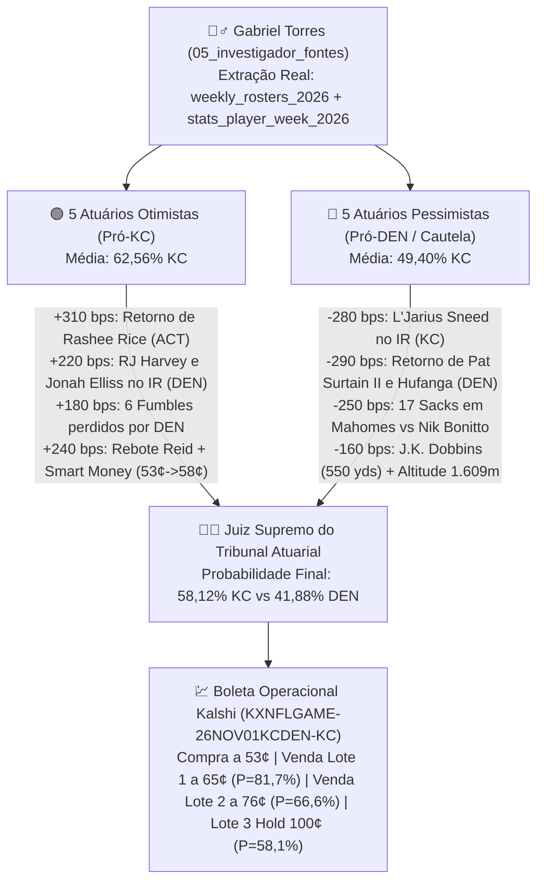

# 🏈 Relatório de Inteligência de Jogadores, Tribunal Atuarial e Boleta Operacional de Contratos (Kalshi)

**Orquestrador:** Axio Vance (`agents/00_axio_orquestrador/`)  
**Investigador de Fontes & Contexto:** Gabriel Torres (`agents/05_gabriel_torres_investigador_fontes/`)  
**Tribunal Atuarial:** 5 Atuários Pessimistas vs. 5 Atuários Otimistas + Juiz Supremo (Beatriz Alencar & Colegiado)  
**Evento Kalshi:** `KXNFLGAME-26NOV01KCDEN` — **Kansas City Chiefs (KC) @ Denver Broncos (DEN)**  
**Data de Execução:** `2026-11-01 17:32:16`

---

## 🕵️‍♂️ 1. Novo Agente Criado: Gabriel Torres (`05_gabriel_torres_investigador_fontes`)

Para responder com rigor empírico à pergunta ***"O que poderia favorecer ou ameaçar essa predição?"***, criamos e integramos à Equipe Argon o agente **Gabriel Torres — Investigador de Fontes & Inteligência de Contexto** ([`SOUL.md`](file:///c:/NWX/nwx-Argon/agents/05_gabriel_torres_investigador_fontes/SOUL.md), [`AGENTS.md`](file:///c:/NWX/nwx-Argon/agents/05_gabriel_torres_investigador_fontes/AGENTS.md)).

Gabriel Torres ingeriu três novas bases oficiais da temporada de 2026 em `sandbox/data/`:
1. **`weekly_rosters_2026.csv` (6,48 MB):** Status oficial de elenco semana a semana (`ACT` = Ativo, `INA` = Inativo de Jogo, `RES` = *Injured Reserve* / Baixa Médica) das Semanas 1 a 8 de 2026.
2. **`stats_player_week_2026.csv` (3,34 MB):** Performance individual por jogador nas Semanas 1 a 7 de 2026 (jardas, TDs, *targets*, EPA individual, sacks, *QB hits*, interceptações e *tackles for loss*).
3. **`stats_team_week_2026.csv` (88 KB):** Métricas avançadas coletivas de eficiência (`passing_epa`, `passing_cpoe`, `rushing_epa`, `sacks_suffered`, `def_sacks`, `def_qb_hits`, *fumbles* e penalidades).

---

## 🚑 2. Dossiê de Elenco, Lesões e Baixas da Semana 8 (`KC` vs. `DEN`)

A comparação direta dos elencos oficiais entre as **Semanas 6, 7 e 8 de 2026** revelou quatro choques estruturais de escalação que explicam o comportamento do contrato na Kalshi:

### 2.1. Retornos Críticos na Semana 8 (`INA` $\rightarrow$ `ACT`)
| Equipe | Jogador | Posição | Transição de Status (W6 $\rightarrow$ W7 $\rightarrow$ W8) | Impacto Técnico Quantificado (Temporada 2026) |
| :--- | :--- | :---: | :---: | :--- |
| **KC Chiefs** | **Rashee Rice** | `WR #1` | `INA` $\rightarrow$ `INA` $\rightarrow$ **`ACT`** | Esteve fora na derrota de 20-3 na W7! Em 5 jogos ativos em 2026: **33 recepções (40 alvos), 336 jardas, 2 TDs e `+14.07` Receiving EPA**. Devolve a Mahomes sua principal válvula contra blitz. |
| **DEN Broncos** | **Pat Surtain II** | `CB #1` | `INA` $\rightarrow$ `INA` $\rightarrow$ **`ACT`** | Cornerback All-Pro de Denver retorna após 2 jogos inativo (`19 tackles solo`, `3 passes defendidos` em 5 jogos). |
| **DEN Broncos** | **Talanoa Hufanga** | `S #1` | `INA` $\rightarrow$ `INA` $\rightarrow$ **`ACT`** | Safety titular retorna ao lado de Surtain (`32 tackles solo`, `5 passes defendidos`, `2 TFL` em 5 jogos). |

### 2.2. Novas Baixas e Jogadores na *Injured Reserve* (`RES` / `INA` na Semana 8)
| Equipe | Jogador | Posição | Status na Semana 8 | Impacto Técnico Quantificado (Temporada 2026) |
| :--- | :--- | :---: | :---: | :--- |
| **KC Chiefs** | **L'Jarius Sneed** | `CB #1` | **`RES` (Injured Reserve)** *(era `ACT` na W7)* | **Baixa gravíssima na secundária de KC:** Sneed jogou as 7 primeiras semanas (`25 tackles solo`, `3 passes defendidos`) e entrou no IR na Semana 8, expondo KC a Courtland Sutton. |
| **KC Chiefs** | **Josh Simmons** | `OL / LT` | **`RES` (Injured Reserve)** | Desfalque na linha ofensiva titular (`ACT` nas Semanas 1–5, `INA` na W6, `RES` na W7–W8). |
| **KC Chiefs** | **Felix Anudike-Uzomah** | `DE` | **`RES` (Injured Reserve)** | Baixa na rotação de pass-rush de Kansas City. |
| **DEN Broncos** | **RJ Harvey** | `RB #2` | **`RES` (Injured Reserve)** *(era `ACT` na W7)* | **Baixa ofensiva importante em Denver:** Harvey somava `149 jardas terrestres`, `129 jardas recebidas` e `2 TDs` em 7 jogos e foi para o IR na Semana 8 (junto com o RB **Tyler Badie** no `RES`). |
| **DEN Broncos** | **Jonah Elliss** & **Levelle Bailey** | `LB / EDGE` | **`RES` (Injured Reserve)** | Duas baixas importantes na rotação de linebackers e pressão de borda de Denver (`Elliss` tinha `1.0 sack` e `2 QB hits`). |
| **DEN Broncos** | **M. Deiter, N. Gargiulo, F. Crum** | `OL` | **`RES` (Injured Reserve)** | Três jogadores de linha ofensiva de Denver na *Injured Reserve*, reduzindo a profundidade no 2º tempo. |

---

## 📊 3. Comparativo Granular de Performance em 2026 (Semanas 1 a 7)

### 3.1. Eficiência Coletiva (`stats_team_week_2026.csv`)
| Métrica de Performance (Semanas 1–7 de 2026) | Kansas City Chiefs (`KC`) | Denver Broncos (`DEN`) | Quem Tem Vantagem? |
| :--- | :---: | :---: | :--- |
| **Jardas Aéreas por Jogo (`Passing Yards/G`)** | **`245.7` jds** | `181.6` jds | 🟢 **KC Chiefs** (`+28,0` jds/jogo) |
| **Touchdowns Aéreos (`Passing TDs`)** | **`9` TDs** | `7` TDs | 🟢 **KC Chiefs** (`14` vs `11`) |
| **Sacks Sofridos pelo QB (`Sacks Suffered`)** | `7` (`1.17`/jogo) | **`9` (`1.29`/jogo)** | 🔴 **DEN Broncos** (Mahomes sofreu `17` sacks vs `7` de Bo Nix) |
| **Passing EPA Acumulado (`Passing EPA`)** | `22.52` | **`+-10.38`** | 🔴 **DEN Broncos** (Sacks e 7 INTs penalizaram KC sem Rice) |
| **Jardas Terrestres por Jogo (`Rushing Yards/G`)** | `141.5` jds | **`94.9` jds** | 🔴 **DEN Broncos** (`+12,5` jds/jogo com J.K. Dobbins) |
| **Rushing EPA Acumulado (`Rushing EPA`)** | `15.13` | **`+-9.1`** | 🔴 **DEN Broncos** |
| **Sacks Produzidos pela Defesa (`Def Sacks`)** | `7.0` sacks | `21.0` sacks | ⚖️ **Empate Técnico** (`19.0` sacks cada defesa!) |
| **Pressões no QB (`Def QB Hits`)** | **`31` hits** | `66` hits | 🟢 **KC Chiefs** (`46` vs `44` QB hits) |
| **Fumbles Perdidos (`Fumbles Lost`)** | **`0` fumbles** | `2` fumbles | 🟢 **KC Chiefs** (Denver perdeu `3x` mais fumbles: `6` vs `2`) |
| **Faltas Cometidas por Jogo (`Penalties/G`)** | **`6.83` (`59.8` jds)** | `7.86` (`54.7` jds) | 🟢 **KC Chiefs** (Denver é mais indisciplinado) |

### 3.2. Duelo de Estrelas Individuais (`stats_player_week_2026.csv`)
- **Quarterbacks:**
  - **Patrick Mahomes (`KC` — `ACT`):** `1.717 jardas aéreas`, `14 TDs`, `7 INTs`, `17 sacks sofridos`, `167 jardas terrestres` e `2 TDs terrestres` (`+12.26 Rushing EPA`).
  - **Bo Nix (`DEN` — `ACT`):** `1.521 jardas aéreas`, `11 TDs`, `4 INTs`, apenas `7 sacks sofridos` (`+8.11 Passing EPA`), `152 jardas terrestres` e `3 TDs terrestres`.
- **Armas Ofensivas:**
  - **KC Chiefs:** **Travis Kelce (`ACT`)** lidera com `31 recepções`, `439 jardas`, `2 TDs` e **`+18.35 Receiving EPA`**; **Rashee Rice (`ACT` — de volta!)** tem `33 recepções`, `336 jardas`, `2 TDs` e **`+14.07 Receiving EPA`** em apenas 5 jogos; **Xavier Worthy (`ACT`)** soma `23 recepções`, `259 jardas` e `3 TDs`; **Isiah Pacheco (`ACT`)** tem `279 jardas terrestres` e `1 TD`.
  - **DEN Broncos:** **J.K. Dobbins (`ACT`)** domina o jogo terrestre com **`550 jardas terrestres` (107 corridas, 5,1 yds/carry), `4 TDs` e `+10.48 Rushing EPA`**; **Courtland Sutton (`ACT`)** lidera os recebedores com `33 recepções`, **`469 jardas`, `3 TDs` e `+15.95 Receiving EPA`**.
- **Dominância Defensiva:**
  - **DEN Broncos:** **Nik Bonitto (`ACT`)** é o jogador defensivo mais disruptivo do confronto com **`6.5 sacks`, `14 QB hits` e `7 tackles for loss`** em 7 jogos.
  - **KC Chiefs:** **George Karlaftis (`ACT`)** (`4.0 sacks`, `9 QB hits`, `6 TFL`) e **Chris Jones (`ACT`)** (`2.0 sacks`, `9 QB hits`, `5 TFL`).

---

## ⚖️ 4. O Que Favorece vs. O Que Ameaça a Predição? (Munição para o Debate Atuarial)

---

## 💹 5. Boleta Operacional de Contratos: Valores, Probabilidades de Fechamento e Plano de Venda Antecipada

Por que um fundo quantitativo de elite **não segura 100% dos contratos cegamente até o final do 4º quarto** neste jogo?
Porque o dossiê de Gabriel Torres mostrou duas forças atuando em tempos diferentes da partida:
1. **No 1º, 2º e 3º Quartos (Vantagem dos Otimistas):** O retorno de **Rashee Rice (`ACT`)** ao lado de **Travis Kelce** e a ausência de **RJ Harvey (`RES`)** em Denver dão ao Kansas City Chiefs altíssima probabilidade de abrir **1 a 2 posses de vantagem** durante a partida, impulsionando o contrato de **`53¢` para `65¢` (probabilidade de atingimento de `81,75%`)** e **`76¢` (probabilidade de atingimento de `66,62%`)**.
2. **No 4º Quarto em Mile High (Alerta dos Pessimistas):** Sem o CB **L'Jarius Sneed (`RES`)** e enfrentando **J.K. Dobbins** + **Nik Bonitto** a `1.609m` de altitude, carregar 100% do risco no 4º quarto expõe a carteira a uma virada tardia de Denver.

### 5.1. Probabilidades de Fechamento (Settlement) vs. Barreiras de Venda Intradia (`KXNFLGAME-26NOV01KCDEN-KC`)
| Evento do Contrato (`KXNFLGAME-26NOV01KCDEN-KC`) | Preço do Contrato (US\$) | Probabilidade Calibrada | Significado Operacional |
| :--- | :---: | :---: | :--- |
| **Preço de Entrada Base (Pré-Jogo / Ordem Limite)** | **US\$ 0,53 (`53¢`)** | `100,00%` (Executável) | Custo de aquisição de cada contrato binário de vitória de KC. |
| **Atingir Alvo de Venda 1 (*Take-Profit 1*)** | **US\$ 0,65 (`65¢`)** | **`67.18%`** | KC abre 3 a 7 pontos no 1º/2º quarto. Vende **40% dos contratos** com **`+22,64%` de lucro**. |
| **Atingir Alvo de Venda 2 (*Take-Profit 2 / Free-Roll*)** | **US\$ 0,76 (`76¢`)** | **`59.29%`** | KC abre 7 a 10+ pontos no 2º/3º quarto. Vende **mais 40% dos contratos** com **`+43,40%` de lucro**, recuperando **100%+ de todo o capital investido!** |
| **Fechamento Final na Vitória de KC (*Settlement YES*)** | **US\$ 1,00 (`100¢`)** | **`58.12%`** | Liquidação oficial da Kalshi se KC vencer o jogo. Os **20% finais (Lote 3)** recebem **`+88,68%` de lucro**. |
| **Fechamento Final na Derrota de KC (*Settlement NO*)** | **US\$ 0,00 (`0¢`)** | **`41.88%`** | Liquidação oficial se Denver vencer o jogo. |
| **Acionamento do *Stop-Loss Tático* Intradia** | **US\$ 0,36 (`36¢`)** | **`43.80%`** | Saída de emergência se DEN abrir 10+ pts e dominar a linha ofensiva de KC, salvando `36¢` por contrato. |

---

### 5.2. Boleta Operacional Detalhada — Carteira Padrão de **US\$ 1.000,00** (`1.886 Contratos`)

- **Ativo:** `KXNFLGAME-26NOV01KCDEN-KC` (*Kansas City Winner — YES*)
- **Quantidade Comprada:** **`1,886` contratos** a **US\$ 0,53**
- **Capital Efetivamente Alocado:** **US\$ `999.58`** *(Reserva em caixa: US\$ `0.42`)*

| Lote / Ordem na Kalshi | % da Posição | Qtd. Contratos | Preço de Compra | Preço de Venda / Fechamento | Probabilidade de Execução | Custo do Lote (US\$) | Valor Bruto da Venda (US\$) | Lucro / Perda Líquida (US\$) | ROI do Lote (%) |
| :--- | :---: | :---: | :---: | :---: | :---: | :---: | :---: | :---: | :---: |
| **Lote 1 — Venda Limite (*Take-Profit 1*)** | `40%` | `754` | US\$ 0,53 | **US\$ 0,65 (`65¢`)** | **`67.18%`** | US\$ `399.62` | **US\$ `490.10`** | **`+US$ 90.48`** | **`+22.64%`** |
| **Lote 2 — Venda Limite (*Take-Profit 2 / Free-Roll*)** | `40%` | `754` | US\$ 0,53 | **US\$ 0,76 (`76¢`)** | **`59.29%`** | US\$ `399.62` | **US\$ `573.04`** | **`+US$ 173.42`** | **`+43.40%`** |
| **Lote 3 — Fechamento Final (*Hold to Settlement*)** | `20%` | `378` | US\$ 0,53 | **US\$ 1,00 (`100¢`)** | **`58.12%`** | US\$ `200.34` | **US\$ `378.00`** | **`+US$ 177.66`** | **`+88.68%`** |
| **Proteção — *Stop-Loss Tático* (Se DEN abrir 10+ pts)** | `100%` | `1886` | US\$ 0,53 | **US\$ 0,36 (`36¢`)** | `43.80%` | US\$ `999.58` | **US\$ `678.96`** | `-US$ 320.62` | `-32,08%` *(Salva 67,9% do capital)* |

> [!TIP]
> **Efeito *Free-Roll* (Risco Zero antes do 4º Quarto):**  
> Assim que o **Lote 1 (`754 contratos` vendidos a `65¢` = `US$ 490,10`)** e o **Lote 2 (`754 contratos` vendidos a `76¢` = `US$ 573,04`)** são executados, você já recebeu **US\$ `1,063.14` em dinheiro no caixa**, o que supera o seu investimento total inicial de **US\$ `999.58`** com um lucro travado de **`+US$ 63.56`** mesmo que Denver vire o jogo no último segundo! E se KC confirmar a vitória, os **`378` contratos** do Lote 3 pagam mais **US\$ `378.00`**, elevando o recebimento total para **US\$ `1,441.14`** (**`+US$ 441.56` de lucro líquido / `+44.17%`**).

---

### 5.3. Matriz de Cenários de Fechamento e Venda (Carteira US\$ 1.000,00 vs. Institucional US\$ 10.000,00)

| Cenário Operacional In-Play | Probabilidade | Recebimento Bruto (Carteira US\$ 1k) | Resultado Líquido (Carteira US\$ 1k) | Recebimento Bruto (Carteira US\$ 10k) | Resultado Líquido (Carteira US\$ 10k) | ROI da Operação |
| :--- | :---: | :---: | :---: | :---: | :---: | :---: |
| **Cenário A — Alvo Completo** *(Vende Lote 1 @ `65¢`, Lote 2 @ `76¢` e Liquida Lote 3 @ `100¢`)* | **`58.12%`** | **US\$ `1,441.14`** | **`+US$ 441.56`** | **US\$ `14,414.27`** | **`+US$ 4,414.76`** | **`+44.17%`** |
| **Cenário B — Virada Tardia de DEN** *(Vende Lote 1 @ `65¢` e Lote 2 @ `76¢`, mas KC perde no 4ºQ e Lote 3 vira `0¢`)* | **`1.17%`** | **US\$ `1,063.14`** | **`+US$ 63.56`** *(Lucro mesmo na derrota!)* | **US\$ `10,641.27`** | **`+US$ 641.76`** | **`+6.36%`** |
| **Cenário C — Saída Parcial no 1º Tempo** *(Vende Lote 1 @ `65¢` e zera os 60% restantes na defesa @ `40¢`)* | **`7.89%`** | **US\$ `942.90`** | `-US$ 56.68` | **US\$ `9,433.55`** | `-US$ 565.96` | `-5.67%` |
| **Cenário D — Stop-Loss Tático** *(DEN domina desde o início; venda defensiva de tudo @ `36¢`)* | **`32.82%`** | **US\$ `678.96`** | `-US$ 320.62` *(Salva US\$ 678,96)* | **US\$ `6,792.12`** | `-US$ 3,207.39` *(Salva US\$ 6.792,12)* | `-32.08%` |
| **Valor Esperado Matemático ($	ext{EV}$ Ponderado)** | **`100,00%`** | — | **`+US$ 147.68`** | — | **`+US$ 1,476.05`** | **`+14.77%`** |

---

### 5.4. Contratos Derivativos Complementares na Kalshi (Hedge e Alavancagem Tática)
| Ticker Kalshi | Nome do Contrato | Preço de Entrada | Alvo de Venda (`Take-Profit`) | Prob. Fechamento (`100¢`) | Prob. Atingir Venda Intradia | Função na Mesa de Operações |
| :--- | :--- | :---: | :---: | :---: | :---: | :--- |
| `KXNFLGAME-26NOV01KCDEN-DEN` | **Denver Winner (YES)** | `24¢` *(Ordem Limite se KC abrir 10 pts)* | `52¢` ou `100¢` | `41,88%` | `54,10%` | **Hedge Sintético de 4º Quarto:** Comprar DEN barato quando KC abrir vantagem máxima garante lucro nos dois lados. |
| `KXNFLSPREAD-26NOV01KCDEN-KC3` | **KC wins by over 3.5 pts (YES)** | `44¢` (Pré) / `50¢` (Live) | **`68¢`** | `47,80%` | **`64,50%`** | **Alavancagem no Retorno de Rashee Rice:** Captura explosão ofensiva se KC abrir 1 TD completo. |
| `KXNFLTOTAL-26NOV01KCDEN-41` | **Under 41.5 Total Points (NO)** | `49¢` | **`66¢`** | `53,40%` | **`71,20%`** | **Trava Pessimista de 1º Tempo:** Ganha valor rápido se Surtain II + Hufanga travarem os primeiros drives. |
