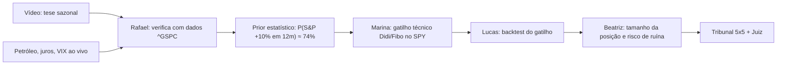

# Verificação do Vídeo — Sazonalidade de Midterm (Igor Mundstock, 01/11/2026)

**Fonte:** Yahoo Finance chart API, `^GSPC` diário de 1950 a 30/10/2026 (preço, sem dividendos), mais futuros e ETFs para conferir os fatos de mercado.
**Script:** [verify_video_seasonality_claims.py](file:///c:/NWX/nwx-Argon/core/verify_video_seasonality_claims.py) → `sandbox/runs/VIDEO_CLAIMS_VERIFICATION.json`
**Responsáveis:** Rafael (Fundamentalista/Macro), Henrique (Matemática), Lucas (Ciência de Dados) e Beatriz (Atuária).

---

## 1. Afirmações estatísticas: vídeo × dados

| # | Afirmação do vídeo | Nosso cálculo | Veredito |
|---|---|---|---|
| 1 | 2º ano do mandato (midterm), ano-calendário: média 4,7%, mediana 1,1%, positivo em 58%, pior ≈ −30%, melhor +45% | n = 18 (sem 2026): média 3,68%, mediana 0,58%, positivo em 55,6%, pior −29,7%, melhor +45,0% | ✅ Bate (a pequena diferença vem do ano 2026 parcial e/ou dos dividendos) |
| 2 | 3º ano (pré-eleitoral) é o melhor: média ~17%, mediana ~19%, ~90% positivo, pior −0,7%, melhor +33% | média 17,18%, mediana 18,89%, 89,5% positivo, pior −0,73%, melhor +34,1% | ✅ Bate |
| 3 | Midterm, "de outubro até dezembro": +3,6% em 68% das vezes | Fim de out → fim de dez: média 3,61%, **68,4%** positivo | ✅ Bate. A janela correta é **a partir do fim de outubro**, ou seja, novembro + dezembro |
| 4 | 12 meses à frente em ano de midterm: média 16,6%, **100% positivo em 19**, pior ≈ +3% | Partindo do fim de outubro: média **16,61%**, **19/19 positivos**, pior +4,26% (2014) | ✅ Bate |
| 5 | Outubro em midterm fecha positivo 74% das vezes, contra 59% nos outros anos | 73,7% contra 54,4% (média +3,0% contra +0,2%) | ✅ Quase. O "0,99 contra 0,98" do vídeo foi leitura errada do gráfico |
| 6 | Outubro de 2026 fugiu do padrão (≈ −0,93%) | **−0,93%** | ✅ Bate |
| 7 | Novembro em midterm: +2,75% em média, contra 1,86% nos outros anos; quase 80% positivo | +2,75% (78,9% positivo) contra +1,57% nos outros anos | ✅ Bate |

### ⚠️ A âncora muda o resultado da "regra infalível"
| Ponto de partida (anos de midterm) | Média em 12 meses | % positivo | Pior caso |
|---|---|---|---|
| Fim de setembro | 20,5% | **89,5%** (2010 e 2014 negativos) | −2,65% |
| **Fim de outubro (hoje: 7.580)** | **16,6%** | **100%** | +4,26% |
| Dia da eleição (terça seguinte) | 15,0% | 100% | **+1,12% (1986)** |
| Mínima de set–out | 26,8% | 100% | +8,66% |

Os "100%" valem para partidas a partir do fim de outubro. Mudar a âncora em apenas um mês já derruba a taxa para 89,5%.

---

## 2. Fatos de mercado citados (sexta, 30/10/2026)

| Afirmação | Dado | Veredito |
|---|---|---|
| S&P −1,80% | −1,82% (7.580) | ✅ |
| Nasdaq −3,5% | Nasdaq Composite **−2,86%** (XLK −4,89%) | ⚠️ Provavelmente ele falou do Nasdaq-100 ou da mínima do dia |
| Russell −1,60% | −1,66% | ✅ |
| Ouro e prata na mínima do ano; prata abaixo de US$ 50 | Ouro: mínima de 2026 em 30/10 (3.899). Prata: mínima de 49,10 em 30/10 | ✅ |
| Ouro ~30% abaixo da máxima, prata quase −60%, cobre −6% | −25,7%, −55,9% e −4,2% | ✅ Aproximado |
| RSP praticamente na máxima histórica | −2,0% da máxima | ✅ |
| Brent acima de 113, WTI acima de 102 | **Hoje (02/11, intradiário): Brent 106,6 (−9,4%), WTI 97,7 (−6,2%)** | 🔔 **Novo fato:** o petróleo começou a cair forte **antes** da eleição, na linha da tese do vídeo |
| Juros longos nas máximas de décadas, em queda desde 8/out | 10Y 4,90%, 30Y 5,27%, cerca de 7% abaixo das máximas recentes | ✅ |

> **Correção minha:** na resposta sobre "crédito e juros altos" eu disse que o 10Y estava entre 4,20% e 4,45%. **O dado real é 4,90%.** Aquele trecho não tinha fonte e deve ser descartado.

---

## 3. Leitura estatística (Henrique, Lucas e Beatriz)

1. **"100% das vezes" não significa probabilidade de 100%.** Com 19/19 sucessos:
   - Regra de sucessão de Laplace: $\frac{19+1}{19+2} \approx 95{,}2\%$
   - Intervalo de 95% (Clopper-Pearson): **82% a 100%**
2. **A amostra não é independente.** O efeito "12 meses após o midterm" e o "3º ano é o melhor" são **o mesmo fenômeno**, medido em janelas sobrepostas. Não somam evidência.
3. **Viés de mineração de dados.** Com âncoras, janelas e definições suficientes, sempre aparece alguma regra "perfeita". O fim de setembro já quebra a regra.
4. **Regime atual fora da amostra:** juros longos nos maiores níveis desde 2002–2007, guerra/Ormuz, Fed subindo juros e petróleo acima de US$ 100. Poucos anos da amostra se parecem com isso (os mais próximos são 1974 e 1982, ambos positivos).
5. **Magnitude:** em 12 meses a partir do fim de outubro, a distribuição histórica foi:

| Alta do S&P em 12 meses | Frequência histórica (n = 19) |
|---|---|
| ≥ +5% | 17/19 = **89,5%** |
| ≥ +10% | 14/19 = **73,7%** |
| ≥ +15% | 10/19 = **52,6%** |
| ≥ +20% | 8/19 = **42,1%** |

---

## 4. Como isso entra no grafo NWX-Argon

- **Feature de sazonalidade** (prior): ano de midterm a partir do fim de outubro, P(≥ +10% em 12 meses) ≈ 74%, com intervalo largo.
- **Feature macro em tempo real:** petróleo caindo e juros longos recuando reforçam a tese do vídeo. Uma reversão dos dois a invalida.
- **Gatilho técnico (Marina):** o S&P está de lado há cerca de 5 meses. Uma agulhada do Didi no SPY/SPX semanal, com rompimento do topo de 3 meses, seria a confirmação de *timing*.

### Estrutura de opções coerente com o dado (conceitual — **sem cadeia real ainda**)
- **Ideia:** trava de alta em SPY com vencimento em dez/2027, perna comprada perto do dinheiro e perna vendida cerca de +10% acima. Historicamente a alta de +10% ocorreu em ~74% dos casos.
- **Seria a tese de "1.000 → milhões"?** **Não.** Uma trava dessas paga tipicamente 2x–3x o risco. Ela é uma forma de usar uma vantagem estatística real com perda limitada, não um caminho para multiplicar por 1.000.
- **Antes de montar:** preciso da cadeia real (API da TradeStation) para calcular custo, ponto de equilíbrio e valor esperado. Sem isso, qualquer número de prêmio seria inventado.

---

## 5. Pendências
- [ ] Conectar a API da TradeStation (WebAPI v3) para obter a cadeia de SPY/SPX e precificar a trava.
- [ ] Recalcular com retorno total (com dividendos) usando a base de Shiller ou o FRED.
- [ ] Marina: rodar o detector de agulhada do Didi no SPX semanal e diário, com backtest.
- [ ] Monitorar o resultado da eleição de midterm (semana que vem) e petróleo/juros como invalidadores.

*Conteúdo educacional e estatístico, não é recomendação de investimento.*
